**Vg1 IM student • Bergen, Norway • Goal: Full-stack dev**

**Live now:** [victorguminski.com](https://victorguminski.com) — tested in a
real browser before every change, deployed with Cloudflare Pages, new VG
favicon (lime #C6FF00 on black, 16:1 contrast).

I started building Roblox games in Lua with friends when I was 14, and in
2025 moved over to HTML, CSS, JavaScript, TypeScript and React so that what I build
runs on the open web, and to React Native so it runs on a phone too. The goal is to become a full stack developer.

## What's new on the site

Rebuilt from scratch: pure black #000000 background, white text, lime #C6FF00
accent. No tracking • Nothing stored or sent anywhere.

- **Live battery** ⚡ + "This device, right now" — detects YOUR device, shows a charging bolt when plugged in.
- **Local time** — detects your device location and ticks every second.
- **IP address** — hidden on purpose. `xxx.xxx.xxx.xxx` is a placeholder, decoration only.
- **Cookie Preferences banner, 100% transparent:**
  - *Strictly Necessary (always on):* `__cf_bm`, `cf_clearance`, `_cfuvid`, `__cflb`, `cf_ob_info` / `cf_use_ob`, `__cfwaitingroom` — Cloudflare Bot Management, Rate Limiting, Load Balancer.
  - *Functional (your choice):* `vg-theme` — remembers dark/light mode, stored in localStorage + cookie (`SameSite=Lax`; `Secure`; expires in 1 year).
  - No Google Analytics, no Facebook Pixel, no ads.

NOTE: THESE LIVE NUMBERS ARE JUST FOR DECORATION. NOTHING IS STORED OR SENT ANYWHERE.

## What I work with

## Experience

**Companion AI & Nordic AI** · March 2026 to August 2026 
Tester and IT employee, mostly on [com2.ai](https://com2.ai/), which is built
with React, TypeScript and Vite on the front and NestJS on Node.js behind it. I
tested the frontend app and its features, read through both the frontend and
backend code, and fixed the bugs I found. Some of the time went to
[nordicai.net](https://www.nordicai.net/).

## Projects

| Project | What it is |
| --- | --- |
| [victorguminski.com](https://github.com/victorguminski18/victorguminski18.github.io) | Vanilla HTML, CSS and JS with light/dark `vg-theme`, animations, security headers and browser tests before every change. |
| [html-css-course](https://github.com/victorguminski18/html-css-course) | HTML and CSS practice projects and exercises from a frontend development course, including a clone of the YouTube start page. |
| [javascript-course](https://github.com/victorguminski18/javascript-course) | My journey learning JavaScript: variables, booleans, functions, a cart quantity exercise and rock paper scissors. |

## Contact

- GitHub: https://github.com/victorguminski18
- LinkedIn: https://www.linkedin.com/in/victor-guminski-518a39368/
- Instagram: https://www.instagram.com/victor_guminski18

© 2026 Victor Guminski — Vg1 IM, Krokeide VGS, Bergen
